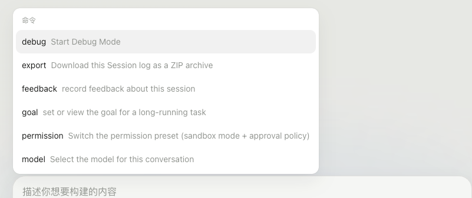

# dsh-debug-mode

[English](README.md) | 中文

为 [DeepSeek Harness](https://github.com/deepseek-ai/deepseek-harness) 提供运行时证据的 Debug Mode 插件。

它不再让 agent 只看源码猜问题，也不需要你在浏览器 console 和服务端日志之间来回复制。Debug Mode 会植入 1–3 个精准探针，将 Browser、Electron 和 Node 的关键事件统一写入结构化 JSONL，再由 agent 基于真实证据修复、验证和清理。

**一条命令，一个证据闭环，不再人工翻日志。**




## 安装与使用

需要 Node.js `^22.19.0 || >=24.0.0`、`PATH` 中可用的 pnpm，以及 DSH `0.1.0-rc.7` 或更高版本。

```sh
dsh plugin --profile web add "github:a554878526/dsh-debug-mode#main"
```

重启 `dsh web`，新建任务：

1. 执行 `/debug` 并描述问题。
2. 按提示复现，然后点击 **Continue**。
3. 确认修复后点击 **Fixed**，让 agent 清理探针、进程和日志。

## JSONL 日志格式

每行是一个独立 JSON 事件：

```json
{"sessionId":"a1b2c3","runId":"pre-fix","hypothesisId":"H1","location":"SessionStore.ts:restore","message":"cache lookup","data":{"hit":true,"entryCount":3,"timestampNs":"1775543428486123456"},"timestamp":1775543428486}
```

用 helper 生成 session id、日志路径、ingest 命令以及可直接复制的 Browser/Electron 和 Node 探针：

```sh
python3 scripts/new_debug_session.py --root .
```

运行时只记录能证明或否定假设的最小数据；不要记录密钥、凭据、PII 或大数组。生成的 `JSON.stringify` replacer 会把 `bigint` 转为十进制字符串，避免序列化失败和精度丢失。

复现后可手动汇总：

```sh
python3 scripts/summarize_debug_log.py .codex-debug/debug-<session>.jsonl
```

正常 Debug Mode 流程中，这些 helper 都由 agent 自动调用。

## 开发

```sh
pnpm install
pnpm run check
dsh plugin --profile web add .
```

本地重装后需重启 profile 并新建任务，确保 DSH 加载新的 Host 和 client bundle。

## 旧版历史修复

`0.1.1` 及更早版本写入过官方 DSH 无法识别的 `debug-mode/state` 事件。停止 `dsh web` 后先检查，再执行带备份的修复：

```sh
python3 scripts/repair_debug_mode_sessions.py
python3 scripts/repair_debug_mode_sessions.py --apply
```

当前 Debug Mode 状态仅存在于 Host 进程中；重启 Host、刷新页面或重新打开任务后，需要再次执行 `/debug`。
